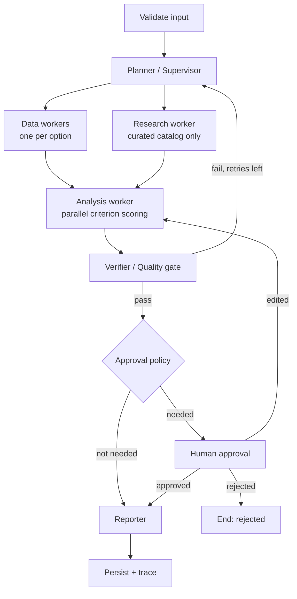

# Aegis AI

A multi-agent decision assistant built with **LangGraph**, **LangChain**, **Microsoft Foundry** and **OpenAI**.

You give Aegis a structured decision task, for example:

> Compare three cloud data platforms for an enterprise. Calculate a weighted decision score based on cost, scalability and security. Run the calculations using tools, explain the recommendation, and ask for approval before finalizing the report.

Aegis breaks the request into steps and sends each step to a specialist agent. Deterministic tools do all the arithmetic. A verifier checks the results, a human approves the output when needed, and Aegis returns a structured decision report.

> **Status:** in active development. This is a 10-day prototype sprint (Nov 17–26, 2026). Items marked *planned* below are not built yet.

Aegis follows enterprise patterns: authentication, least privilege, audit trails and spending limits. It is a portfolio project. It does not claim regulatory compliance and is not certified for production.

---

## Features (v1 scope)

| Area | What it covers |
|---|---|
| Orchestration | LangGraph supervisor with worker agents, parallel fan-out, conditional routing |
| Tool calling | Calculator, normalization, weighted scoring, read-only SQL |
| Verification | Independent recomputation of every number, source grounding, schema checks, LLM judge, bounded retries |
| Human-in-the-loop | Interrupt, then approve, edit or reject, then resume, even after a restart |
| Persistence | PostgreSQL checkpoints and durable run records |
| Multi-model | One gateway in front of Microsoft Foundry and OpenAI, with the model chosen per role |
| Evaluation lab | Benchmark datasets, trajectory evals, comparison of three architectures |
| Security | Input validation, RBAC on approvals, token and cost budgets |
| Frontend | Agent Workspace, Execution Explorer, Approval Center, Evaluation Lab |

**Not in v1:** RAG, MCP, open-web research, long-term memory, multi-tenancy, Kubernetes. The architecture leaves room to add them in v2.

Aegis uses only user-provided or bundled structured data. Every fact in a report must cite a source in that data, so the system cannot invent prices or product capabilities.

---

## Architecture



- **Agents (LLM-backed):** Planner, Data, Research, Analysis, Reporter.
- **Deterministic nodes (plain code):** input validation, verification checks, approval policy, budget guard.
- **The LLM never does arithmetic.** It plans and explains. Tools calculate, and the verifier recalculates every number.

---

## Tech stack

- **Python 3.12**, managed with [uv](https://docs.astral.sh/uv/)
- **LangGraph / LangChain** for orchestration and agents
- **Microsoft Foundry** and **OpenAI** for models
- **FastAPI** backend *(planned)*
- **PostgreSQL** for checkpoints and run data *(planned)*
- **Next.js** frontend *(planned)*
- **Azure Container Apps** and **GitHub Actions** for deployment and CI *(planned)*

---

## Getting started

### Prerequisites

- Python 3.12
- uv
- An OpenAI API key and/or a Microsoft Foundry model deployment

### Setup

```bash
git clone <repo-url>
cd aegis-agentic-ai
uv sync
cp .env.example .env    # then fill in your keys
```

### Environment variables

| Variable | Purpose |
|---|---|
| `OPENAI_API_KEY` | OpenAI API key |
| `LLM_MODEL` | Default model name |
| `AZURE_OPENAI_ENDPOINT` | Foundry endpoint URL |
| `AZURE_OPENAI_API_KEY` | Foundry API key |
| `AZURE_OPENAI_DEPLOYMENT` | Foundry deployment name (not the model name) |
| `AZURE_OPENAI_API_VERSION` | Foundry API version |

Never commit `.env`. It is listed in `.gitignore`.

### Run

```bash
uv run python main.py
```

*Planned:*

```bash
uv run uvicorn aegis.api.main:app --reload   # backend on http://localhost:8000
uv run pytest                                # offline tests (no API cost)
uv run pytest -m live                        # live provider smoke tests
```

---

## Project structure (planned)

```
aegis-agentic-ai/
├── src/aegis/
│   ├── config.py          # settings loaded from .env (secrets never printed)
│   ├── llm/               # model gateway, usage and cost tracking
│   ├── schemas.py         # request, plan and report models
│   ├── state.py           # LangGraph state and reducers
│   ├── tools/             # calculator, scoring, SQL
│   ├── agents/            # data, research, analysis, verifier subgraphs
│   ├── nodes/             # planner, approval, reporter
│   ├── graphs/            # graph builders for experiments A, B and C
│   └── api/               # FastAPI app
├── notebooks/             # exploration notebooks, numbered 00–10
├── evals/                 # benchmark datasets and evaluators
├── tests/
└── frontend/              # Next.js app
```

---

## Evaluation

The project tests one question:

> Does multi-agent orchestration with verification improve task success enough to justify the extra latency, complexity and cost?

| Experiment | Architecture |
|---|---|
| A | Single agent with all tools (baseline) |
| B | Supervisor and specialist workers |
| C | Supervisor, workers, verification, bounded replanning and human approval |

**Metrics:** correctness, routing accuracy, tool precision, tool-call count, end-to-end latency, cost per successful task. Failed trajectories are reviewed by hand, not only scored.

The benchmark grows from 15 cases (Day 2) to 100 cases (Day 9). Most deterministic and security cases use mocks or recorded fixtures, so they cost nothing to run.

---

## Roadmap

- [ ] **Day 1:** project setup, model gateway (Foundry + OpenAI), FastAPI health endpoint, smoke tests
- [ ] **Day 2:** state and schemas, tools, first 15 eval cases
- [ ] **Day 3:** single-agent baseline, planner and routing
- [ ] **Day 4:** worker subgraphs with parallel execution
- [ ] **Day 5:** verifier, bounded retry, human approval, Postgres persistence
- [ ] **Day 6:** full graph, streaming API
- [ ] **Day 7:** frontend, containers, CI, deployment to Azure
- [ ] **Day 8:** security tests, Execution Explorer
- [ ] **Day 9:** full A/B/C comparison on 100 cases
- [ ] **Day 10:** documentation, demo scenarios, release
