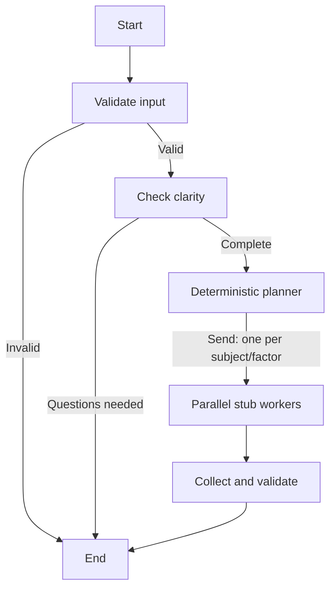

# Routing prototype — Day 3

## Execution boundaries

- Invalid requests finish with `failed`.
- Incomplete requests finish with `needs_clarification`.
- Complete requests dispatch independent evidence tasks.
- Parallel updates merge through the shared state reducers.
- The collector validates references and checks task completion.
- The successful prototype path finishes with `degraded` because
  evidence is synthetic and analysis tasks have not executed.
- No model calls, web requests or final reports are produced.

For three subjects and two factors, the graph runs six stub workers.
The six analysis tasks remain planned but unexecuted.